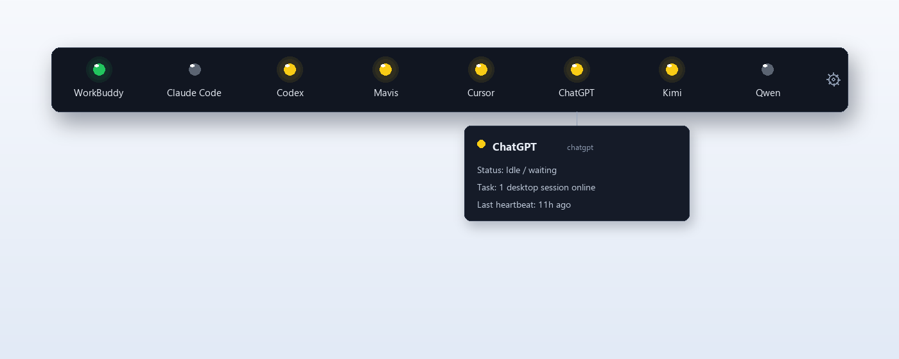
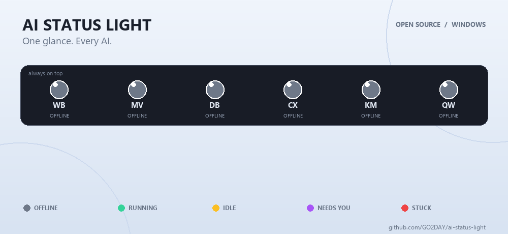

# AI Status Light

**A software busy light for your AI agents.**

Run several AI assistants in parallel (Claude Code, Kimi, DeepSeek, Doubao, Copilot and more)? Stop alt-tabbing to check on them. AI Status Light is a tiny always-on-top strip that shows one colored light per AI — green = working, yellow = idle, purple = needs you, flashing red = stuck, gray = offline.

> 🖥️ Think of it as a [BusyLight](https://www.kuando.com/busylight/) — but software, and for AI agents instead of your office desk.

---

## ⚡ 30-second quick start

1. Download the latest `AIStatusLight-*-x64-Setup.exe` (installer) or `AIStatusLight-*-Portable.exe` (portable, no install) from [Releases](https://github.com/GO2DAY/ai-status-light/releases/latest).
2. Double-click. A slim light strip docks to the top of your screen.
3. Done. It **automatically discovers** the AI assistants already running on your machine and lights them up. No plugins, no API keys, no config.

Prefer the portable build? Just run the downloaded `AIStatusLight-*-Portable.exe` — nothing is written to your system.

## ✨ Features

- **🔍 Zero-config auto-discovery** — detects 15+ AI assistants (Claude Code, Kimi, DeepSeek, Doubao, WorkBuddy, Copilot and more) by watching their windows and processes. No extension or plugin to install in the AI app.
- **🧵 Thread-level conversation list** — not just "busy/idle". Each light tells you `2 chats · generating「topic title」`, so you know *which* conversation is running and what it's about.
- **☁️ Cloud bridge (MQTT)** — running AI agents on a cloud PC or another machine? Publish their status over MQTT and they show up on your local light strip too.
- **🚦 Five-state lights with status words** — 🟢 working · 🟡 idle · 🟣 needs human input · 🔴 flashing = stuck · ⚫ offline. Since v1.6.3 each lamp also prints its status word right under the AI's name — readable at a glance, no hovering.
- **🔊 Sound alerts** — purple/red states trigger a repeating audible alert (every 30s, 3 volume levels, per-app blacklist) so you never miss an agent crying for help.
- **⚙️ Fully self-serve settings** — add/remove/edit lights, drag in a shortcut to add a new AI, manage the sound blacklist. No config files to hand-edit.
- **📌 Always-on-top, drag anywhere** — a slim strip that stays out of your way until it matters.

## 📸 UI preview

*Illustrative recreation of the actual UI. Agent names and count are fully configurable — this strip shows a sample setup. Hover any lamp for status, current task and last heartbeat.*

## 🎬 In motion

🟢 Running · 🟡 Idle / waiting · 🟣 Needs your input · 🔴 **Flashing** = stuck / needs help · ⚪ Offline

## ❓ FAQ

**Do I need to install a plugin in each AI app?**
No. That's the point. AI Status Light watches the AI's window and process from the outside — conversational AI apps (Doubao, Kimi, DeepSeek, ChatGPT desktop, …) work out of the box with zero integration.

**Which AI assistants are supported?**
15+ are auto-detected out of the box, and you can add any app yourself in Settings — just drag its shortcut onto the panel.

**Does it send my data anywhere?**
No telemetry, no analytics, no accounts. The optional MQTT cloud bridge only fires if *you* configure it, and it publishes status snapshots only (agent name / state / task title) to the broker *you* choose.

**Does it work on macOS / Linux?**
Windows 10/11 only for now. The codebase is Electron, so ports are possible — contributions welcome.

**Is there a mobile companion?**
An Android floating-window app (same lights, live sync over MQTT) is in development — coming soon.

**Why does a light show "needs human input"?**
Many agents pause for confirmations, permissions or captchas. Purple means "the AI is waiting on *you*" — the most expensive state in a parallel workflow.

## 🗺️ Roadmap

- [x] Auto-discovery + five-state light strip
- [x] Thread-level conversation status
- [x] MQTT cloud bridge
- [ ] Android companion app (coming soon)
- [ ] macOS / Linux builds
- [ ] Community-contributed AI detection signatures

## 🤝 Contributing

Issues and PRs welcome — especially new AI detection signatures and platform ports. Please keep PRs small and focused.

## 💌 Paid phone-call alert deployment

The app is **free and open source** — download and use it at no cost. Wiring up the **phone-call alert** feature (when an AI gets stuck, the light can trigger a real phone call to you) needs a small server-side setup. If you'd like me to deploy it for you, email **zekaiwu747@gmail.com** and we'll arrange a paid setup. Everything else in the app works out of the box.

## 📄 License

[MIT](LICENSE) © ai-status-light contributors

---

<!-- STAR-HISTORY-PLACEHOLDER

-->

<!-- GROWTH-HOOK-PLACEHOLDER: see growth-hook.md for the recommended one-liner to insert here -->
