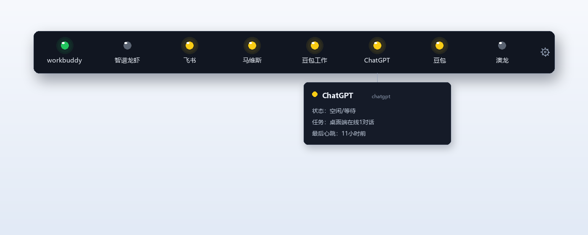
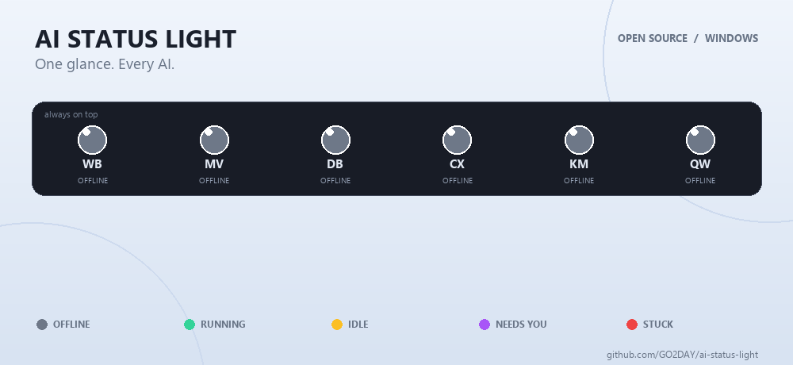

# AI 状态灯（AI Status Light）

**豆包、Kimi、DeepSeek 一起开，谁卡住了？扫一眼屏幕顶上的灯就知道。**

现在用 AI 的常态是同时挂着好几个：DeepSeek 在写方案，Kimi 在整理资料，豆包在生成图片，Claude Code 在跑代码。问题是——它们不吭声。你得挨个切窗口回去看：跑完没？卡住了？还是正等你点"确认"？

AI 状态灯是一个 Windows 置顶小灯条：**一个 AI 一盏灯**，🟢 干活中 · 🟡 空闲 · 🟣 等你处理 · 🔴 红闪 = 卡住 · ⚫ 离线，灯下还直接标着状态词（v1.6.3 起）。不用切窗口，余光一扫就知道哪个 AI 需要你了。

## 30 秒上手

1. 去 [Releases](https://github.com/GO2DAY/ai-status-light/releases/latest) 下载最新的 `AIStatusLight-*-x64-Setup.exe`（安装版）或 `AIStatusLight-*-Portable.exe`（绿色版，免安装）。
2. 双击运行，屏幕顶部出现一条小灯条。
3. 完事。它会**自动发现**你电脑上正在运行的 AI，直接亮灯——不装插件、不配 API、不用改任何设置。

## 它好在哪

- **🔍 不用装插件，自动认出 15+ 个 AI**：豆包、Kimi、DeepSeek、Claude Code、WorkBuddy、Copilot…… 它从外面"看"AI 的窗口和进程来判断状态，对话型 AI 开箱即用。新出的 AI 也能自己加——把快捷方式拖进设置面板就行。
- **🧵 精确到对话**：不只是"忙/闲"。每盏灯能显示"**2 对话 · 生成中「报销方案初稿」**"——哪个 AI、几个对话、聊到哪儿，一目了然。
- **🟣 专治"AI 在等你"**：AI 弹确认框、要授权、卡验证码时亮紫灯 + 声音提醒（每 30 秒重复，三档音量，可拉黑某个不重要的）。多开 AI 最贵的不是 token，是你没看见它在等你。
- **☁️ 云电脑上的 AI 也能上灯**：通过 MQTT 云端桥，云主机/另一台电脑上的 AI 状态实时同步到本地灯条。
- **⚙️ 设置全自助**：增删改灯、拖快捷方式添加、音量、黑名单，全在面板里点，不用手改配置文件。

## 界面预览

*按实际界面复刻的示意图。灯的名称与数量可自定义，上图为一套示例配置。*

## 状态变化演示

🟢 运行中 · 🟡 空闲/等待 · 🟣 需要你确认 · 🔴 **闪烁** = 卡住/需要人工介入 · ⚪ 离线

## 常见问题

**要在每个 AI 里装插件吗？**
不用，这是本工具最大的不同。它从外部观察 AI 窗口，对话型 AI（豆包/Kimi/DeepSeek/ChatGPT 桌面版……）直接就能用。

**会不会上传我的数据？**
不会。没有遥测、没有统计、不用注册。MQTT 云端桥是可选项，只有你自己配置了才会启用，而且只发状态快照（AI 名/状态/任务标题）到你指定的 broker。

**支持 Mac / Linux 吗？**
目前只有 Windows 10/11。代码是 Electron 的，欢迎贡献移植。

**手机上能看吗？**
安卓悬浮窗 APP（同款灯、MQTT 实时同步）开发中，coming soon。

## 参与贡献

欢迎 Issue 和 PR——尤其是新 AI 的识别特征和 Mac/Linux 移植。

## 付费电话通知部署

本软件**完全免费、开源**，下载即用、不收任何费用。但「电话通知」功能（AI 卡住时，灯能真的给你打电话）需要一小套服务端配置。如果你想要我帮你部署这套功能，发邮件到 **zekaiwu747@gmail.com**，我们沟通付费部署事宜。软件其它所有功能都能开箱即用。

## 许可证

[MIT](LICENSE) © ai-status-light contributors

---

<!-- STAR-HISTORY-PLACEHOLDER -->
<!-- GROWTH-HOOK-PLACEHOLDER：引流钩子插入位，文案见 growth-hook.md -->
